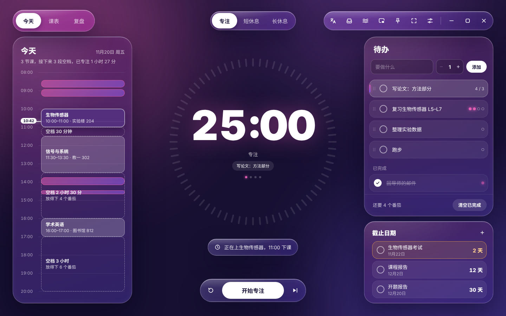
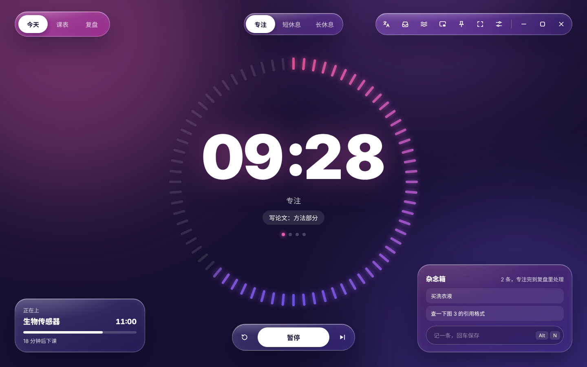
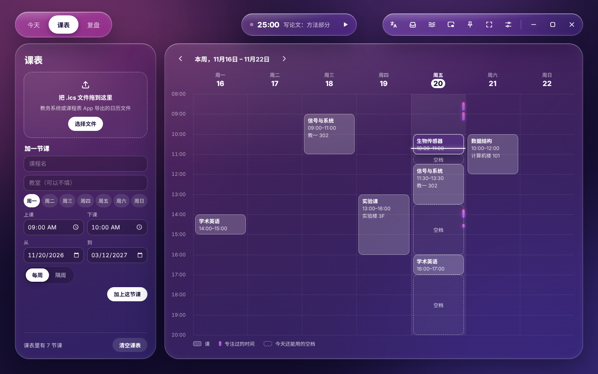
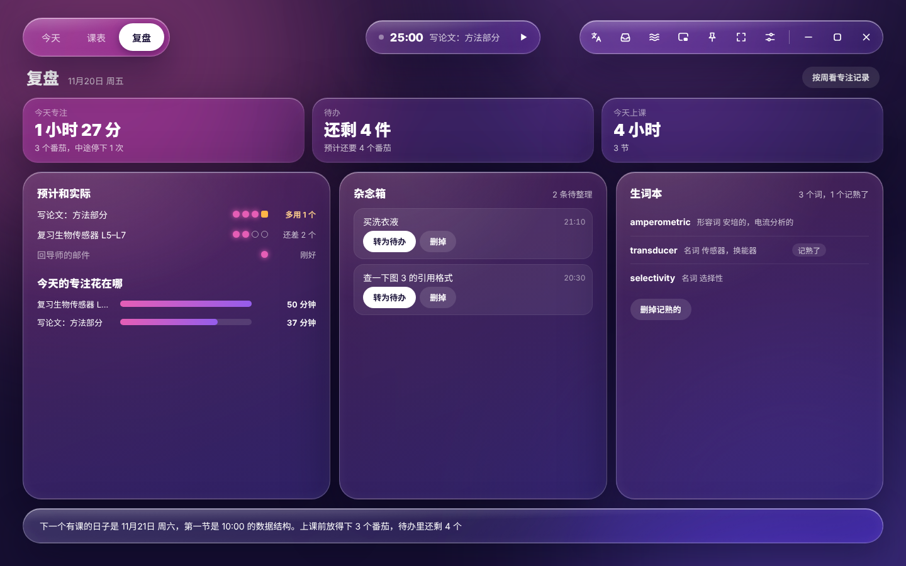
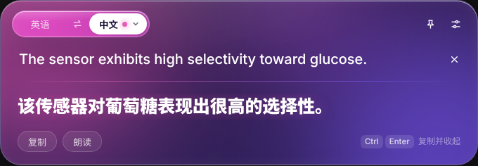
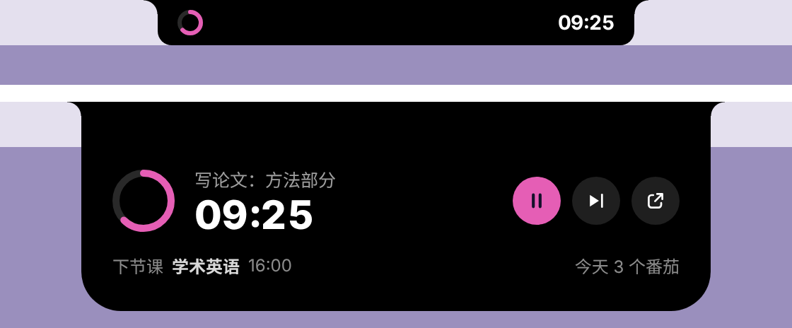

# ingwork

**课表、待办、番茄钟和翻译放在一起的效率软件，Windows 和 Mac 都能用。** ing 系列的一员，从 ingclock（番茄钟）长出来，合并了 ingtranslate（翻译小窗）。打开它就能回答"我现在该做什么"：今天的课和空档排成一条时间轴，待办绑在番茄上，离下节课不够一个番茄时会提醒你改短。数据只存在你自己的电脑上，也可以放进 OneDrive 在几台电脑之间同步。

用 Tauri 2（Rust）+ React 写成。



| 专注中 | 课表 | 复盘 |
| --- | --- | --- |
|  |  |  |

| 翻译小窗 | 杂念箱 |
| --- | --- |
|  |  |

截图里的课程和待办是示例。

---

## 目录

- [功能](#功能)
- [下载安装](#下载安装)
- [从 ingclock 和 ingtranslate 换过来](#从-ingclock-和-ingtranslate-换过来)
- [使用说明](#使用说明)
- [快捷键](#快捷键)
- [导入课表](#导入课表)
- [Mac 上和 Windows 有什么不一样](#mac-上和-windows-有什么不一样)
- [常见问题](#常见问题)
- [从源码运行](#从源码运行)
- [打包与发布新版本](#打包与发布新版本)
- [项目结构](#项目结构)
- [许可证](#许可证)

---

## 功能

**今天**（主界面）
- **时间轴**：左边一栏从早排到晚，课、已经专注过的时间、接下来的空档都在上面，一根白线标着现在。每段空档写着放得下几个番茄。
- **番茄钟**：和 ingclock 一样，专注、短休息、长休息，到点提醒，环境音，主窗口关了也照常走。
- **空档提示**：还没开始的专注，离下节课又不够一段时，倒计时下面会说还有多久，给一个"这一段改成 20 分钟"的按钮，只改这一段，不动设置。正在上课时说一句几点下课。
- **待办**：常驻在右边。每个待办填预计要几个番茄，点一下设成当前待办，每走完一段专注自动给它记一个番茄。
- **截止日期**：考试、交作业，按日子排，三天以内的标出来。
- **专注布局**：专注开始后两边收起来，只留倒计时、下节课和杂念箱；暂停或休息时展开。设置里可以关。
- **休息时复习生词**：休息时从生词本里拿一个词出来，先想意思再翻开看。

**课表**
- 导入学校教务系统或课程表 App 导出的 `.ics` 文件，也可以一节节加。
- 一周的课、实际专注过的时间、今天剩下的空档叠在一起看。点一节课可以改或删。
- 课前提醒：上课前几分钟发一条系统通知，这个时间也是空档计算里留给路上的时间。

**复盘**
- 今天专注了多久、几个番茄、还剩几件待办。
- 预计和实际：每个待办预计几个番茄、实际用了几个；做完的够三件后，告诉你平时估多了还是估少了。
- 今天的专注花在哪些待办上。
- 杂念箱：专注时记下的东西在这里转成待办或删掉。
- 生词本：翻译小窗里加进来的词。
- 下一个有课的日子第一节是什么，上课前放得下几个番茄。
- "按周看专注记录"打开 ingclock 原来的统计面板。

**翻译小窗**（从 ingtranslate 搬过来）
- 按快捷键在鼠标所在的屏幕上方呼出，打字即译，按 Esc 收起；点到别处自动收起，点图钉可以固定。
- 复制了文字再呼出会直接翻译。
- 默认用免费接口（Google 翻译，连不上换 MyMemory），也可以填自己的 OpenAI 兼容接口。
- 查单个英文单词时显示词性和常见释义，可以加进生词本。

**杂念箱小窗**
- 专注时想到别的事，按快捷键呼出，写一句回车就记下、自动收起，不用切到主窗口。

**其他**（和 ingclock 一样）
- 桌面小组件、托盘、全屏、总在最前、自定义背景和配色、中文 / English、开机自启、检查更新。
- 数据文件夹可以换到 OneDrive 里，任务、专注记录、课表、截止日期、杂念箱和生词本都会跟着同步。
- ingfy 的灵动岛照样能显示番茄（沿用 ingclock 的联动文件）。

---

## 下载安装

打开本仓库的 [Releases](../../releases) 页面，下载最新版本。

**Windows**：下载 `ingwork_x.y.z_x64-setup.exe`
1. 双击安装。默认装在当前用户下，不需要管理员权限。电脑上没有 WebView2 时，安装程序会自动下载。
2. 第一次运行时 Windows 可能弹出"Windows 已保护你的电脑"（安装包没有付费签名）。点 **更多信息 → 仍要运行** 即可。

**Mac**：下载 `ingwork_x.y.z_universal.dmg`（M 系列和 Intel 都能用）
1. 打开 `.dmg`，把 ingwork 拖进"应用程序"文件夹。
2. 安装包没有付费签名，第一次打开时系统会拦下来。打开"系统设置 → 隐私与安全性"，在下面找到 ingwork，点 **仍要打开**。
3. 如果提示"已损坏，无法打开"，在终端里运行一次 `xattr -cr /Applications/ingwork.app` 再打开。
4. 第一次上课提醒时，系统会问要不要允许 ingwork 发通知，选允许。

**系统要求**：Windows 10 / 11（64 位），或 macOS 11 以上。

---

## 从 ingclock 和 ingtranslate 换过来

- **第一次打开 ingwork 时**，会把 ingclock 的待办和专注记录复制过来（ingclock 那边的不动）。之后两边各管各的，不再同步。
- **ingtranslate 的设置**（翻译引擎、大模型接口、目标语言、呼出快捷键、界面大小）第一次打开时会接过来。
- **不要同时开着 ingclock 和 ingwork**：两个都会写 ingfy 的联动文件，灵动岛会在两边之间来回跳。
- **不要同时开着 ingtranslate 和 ingwork**：两边默认都用 `Alt + Q` 呼出翻译，后开的那个会注册不上（设置 → 快捷键里会提示"被别的软件占用了"）。
- 主题、背景、小组件位置这些外观设置不会接过来，在"设置 → 外观"里重新选一次。

---

## 使用说明

- 顶栏左边切换"今天 / 课表 / 复盘"三页，下次打开还在上次那一页。不在"今天"页时，顶栏中间是一个小计时，点它回到今天。
- 顶栏右边从左到右：翻译、杂念箱、环境音、桌面小组件、总在最前、全屏、设置，然后是最小化、最大化、关闭。
- 在"今天"页，鼠标 3 秒不动，顶栏和底栏会收起来；动一下就回来。课表和复盘页不收。
- 专注布局里，点倒计时下面的待办名字会从右边拉出待办面板。
- 空格键开始 / 暂停（光标在输入框里时不算）。

---

## 快捷键

全局快捷键在任何程序里都能用，都可以在"设置 → 快捷键"里改：

| 做什么 | Windows | Mac |
| --- | --- | --- |
| 呼出翻译 | `Alt + Q` | `⌃⌥T` |
| 记一条杂念 | `Alt + N` | `⌃⌥I` |
| 开始 / 暂停 | `Ctrl + Alt + P` | `⌃⌥P` |
| 跳过这一段 | `Ctrl + Alt + N` | `⌃⌥N` |
| 显示 / 隐藏主窗口 | `Ctrl + Alt + O` | `⌃⌥O` |
| 显示 / 隐藏小组件 | `Ctrl + Alt + W` | `⌃⌥W` |

Mac 上翻译和杂念箱没有沿用 Windows 的 `⌥Q`、`⌥N`：`⌥` 加字母在 Mac 上是用来打特殊字符的（`⌥N` 是 ñ 上那个波浪号），被全局快捷键占了就打不出来。Mac 上也可以录 `⌘` 组合。

翻译小窗里：

| 做什么 | Windows | Mac |
| --- | --- | --- |
| 立即翻译 | `Enter`（`Shift + Enter` 换行） | `↩`（`⇧↩` 换行） |
| 复制译文并收起 | `Ctrl + Enter` | `⌘↩` |
| 交换语言 | `Alt + S` | `⌥S` |
| 放大 / 缩小 / 恢复界面 | `Ctrl + 加号` / `Ctrl + 减号` / `Ctrl + 0` | `⌘ +` / `⌘ -` / `⌘0` |
| 收起 | `Esc` | `Esc` |

主窗口里：全屏 `F11`（Mac 上也可以 `⌃⌘F`），`Esc` 关掉面板或退出全屏，`空格` 开始 / 暂停。

---

## 导入课表

1. 在学校的教务系统或课程表 App 里找"导出到日历"或"导出 .ics"，得到一个 `.ics` 文件。
2. 在 ingwork 的"课表"页把文件拖进左上角的框里，或者点"选择文件"。
3. 看一眼找到了几节课，选"导入这些课"（已经有课表时可以选"替换现有课表"或"加到现有课表"）。

能认的写法：每周重复的课（含隔周、到某天为止、上几次为止、某几天不上）、单独调过时间的某一次、每周各写一个事件的导出方式（会合成一节每周上的课，中间缺的周记成不上）、带时区的时间（换成这台电脑的本地时间）。全天的事件和跨天的事件不是课，会跳过。

暂时不认 Excel 表格，表格格式的课表可以先在课程表 App 里导入，再导出 `.ics`。

---

## Mac 上和 Windows 有什么不一样

- 窗口左上角用系统的红黄绿按钮。
- 小组件可以放在刘海上（"设置 → 小组件 → 显示在 → 刘海"），像灵动岛一样：计时时刘海两边露出进度环和剩余时间，鼠标移上去往下展开，能暂停、跳过，还能看到下一节课。收起时鼠标穿透，不挡菜单栏。没有刘海的 Mac 上显示成菜单栏正中的一颗胶囊。

  

- 托盘图标在屏幕顶部的菜单栏里，旁边一直显示剩余时间；点一下出菜单。"设置 → 通用"里可以设成只在菜单栏显示，不占程序坞。
- 在别的软件里呼出翻译或杂念箱，用完收起后，ingwork 会整个藏起来（和 `⌘H` 一样），焦点回到你原来在用的软件，可以接着打字。点程序坞图标或菜单栏图标就能把主窗口叫回来。桌面小组件开着时不藏（藏起来小组件也会跟着消失），这时要点一下原来的软件；刘海番茄开着时也不藏，只是把前台还给原来的软件。
- 和 ingfy 的联动用不了（ingfy 只有 Windows 版），别的功能都一样。Windows 和 Mac 可以用同一个 OneDrive 文件夹同步待办、记录和课表。
- 从 ingtranslate 接设置这一步在 Mac 上只接引擎和接口，不接快捷键。

---

## 常见问题

**翻译小窗呼不出来**
看"设置 → 快捷键"里"呼出翻译"那一行有没有写"被别的软件占用了"。多半是 ingtranslate 还开着，退出它，或者换一个组合。

**时间轴上的空档比实际多**
空档是按课表算的，不知道你还有别的安排。课前提醒的时间（默认 10 分钟）会从空档里扣掉，当作路上的时间，在"设置 → 课表"里改。

**"这一段改成 20 分钟"之后，下一段为什么又是 25 分钟**
这个按钮只改这一段，不动设置。改短的这一段走完也算一个完整的番茄。

**课表导入后时间差了几个小时**
`.ics` 里写的是别的时区（比如学校在国内、你在英国），ingwork 会换成这台电脑的时区显示。如果学校导出的文件没写时区，就按本地时间算。

---

## 从源码运行

**需要先安装：**
- [Rust](https://rustup.rs)（Windows 上安装时选默认的 MSVC 工具链）
- [Node.js](https://nodejs.org) 20 以上，然后 `npm install -g pnpm`
- Windows：Visual Studio 2022 的 **"使用 C++ 的桌面开发"** 工作负载（或单独的 Build Tools）
- Mac：Xcode 命令行工具，终端里运行 `xcode-select --install`

**运行：**

```bash
git clone https://github.com/Ingram5656/ingwork.git
cd ingwork
pnpm install
pnpm tauri dev
```

`pnpm install` 提示构建脚本被忽略时，跑一次 `pnpm approve-builds`，允许 `esbuild`。

---

## 打包与发布新版本

### 发布新版本（GitHub 自动打包）

没有 Mac 也能发 Mac 版：推一个标签，GitHub 会在它自己的 Windows 和 Mac 电脑上各打一个安装包（`.github/workflows/release.yml`）。

1. 改版本号，三处保持一致：`package.json`、`src-tauri/Cargo.toml`、`src-tauri/tauri.conf.json`。
2. 在 `CHANGELOG.md` 里把"未发布"的内容挪到新版本下，标题写成 `## [0.1.0] - 日期` 这样。
3. 提交、推送，然后推一个标签：

   ```
   git tag v0.1.0
   git push origin v0.1.0
   ```

4. 十几分钟后 Releases 页面里会多一个草稿，附件里有 `.exe` 和 `.dmg`，说明自动取 CHANGELOG 里这一版的内容。检查一遍，点 **Publish release**。

检查更新读的是 `Ingram5656/ingwork` 最新的 Release，仓库名不一样的话改 `src-tauri/src/update.rs` 开头那两行。发现新版本时，Windows 上下载并运行安装程序；Mac 上打开下载好的 `.dmg`，把新版拖进"应用程序"盖掉旧的。

### 在自己电脑上打包

不要直接 `pnpm tauri build`，用脚本：它会先关掉正在运行的 ingwork，打包时抹掉程序里带你用户名的路径，最后检查一遍，看到 `[OK]` 才能拿去给别人。

Windows：

```powershell
scripts\build-release.cmd
```

Mac（第一次先运行 `rustup target add aarch64-apple-darwin x86_64-apple-darwin`）：

```
sh scripts/build-release.sh
```

打出来的安装包：
- Windows：`src-tauri\target\release\bundle\nsis\ingwork_x.y.z_x64-setup.exe`
- Mac：`src-tauri/target/universal-apple-darwin/release/bundle/dmg/ingwork_x.y.z_universal.dmg`

---

## 项目结构

```
.github/workflows/
  release.yml             推标签后自动打 Windows 和 Mac 的安装包
scripts/
  build-release.cmd       在 Windows 上打包
  build-release.sh        在 Mac 上打包
src/
  main.tsx                按窗口标签决定显示哪个界面：主窗口、小组件、刘海番茄、翻译、杂念箱
  styles.css              全部样式。1–15 节是 ingclock 原有的，16 节以后是 ingwork 新加的
  views/
    MainView.tsx          主窗口：三页、顶栏、底栏
    SchedulePage.tsx      课表页：导入、加课、周视图
    ReviewPage.tsx        复盘页
    TranslateView.tsx     翻译小窗（从 ingtranslate 的 renderer/app.js 改写）
    CaptureView.tsx       杂念箱小窗
    WidgetView.tsx        桌面小组件
    IslandView.tsx        Mac 的刘海番茄（灵动岛）
  components/
    Timeline.tsx          今天的时间轴
    TodayCards.tsx        空档提示、复习生词、下节课、杂念箱
    Deadlines.tsx         截止日期
    TasksPanel.tsx Clock.tsx StatsPanel.tsx SettingsPanel.tsx …  （ingclock 原有，稍有改动）
  lib/
    planner.ts            课表、截止日期、杂念箱、生词本的数据
    schedule.ts           日期计算：某天的课、空档、下节课、放得下几个番茄
    ics.ts                读 .ics 文件
    popups.ts             翻译和杂念箱小窗、接过 ingtranslate 的设置
    reminders.ts          上课提醒
    now.ts                按分钟刷新的"现在"
    …                     其余和 ingclock 一样
src-tauri/
  tauri.conf.json         窗口和打包设置
  tauri.macos.conf.json   Mac 上不一样的窗口（红黄绿按钮、刘海番茄）和打包设置（.app、.dmg）
src-tauri/src/
  lib.rs                  接线：命令、托盘、窗口
  planner.rs              课表、截止日期、杂念箱、生词本：存 planner.json，几台电脑共用时逐条合并
  popup.rs                翻译和杂念箱小窗：呼出、收起、大小跟着页面走
  island.rs               Mac 的刘海番茄：窗口放到菜单栏上面、读刘海的位置、鼠标移上去展开
  translate.rs            三个翻译引擎（从 ingtranslate 搬过来）
  legacy.rs               第一次启动时接过 ingclock 的数据、读 ingtranslate 的设置
  logic.rs                纯逻辑，带测试：小窗尺寸、语言判断、按条目合并
  timer.rs tasks.rs stats.rs location.rs widget.rs link.rs sound.rs update.rs …  （ingclock 原有）
mcp/ingwork-mcp.mjs       让 AI 助手读写待办（和 ingclock 的一样，只认待办）
docs/                     设计风格、开发指南、截图
```

`logic.rs` 的测试不依赖任何库，可以直接跑：`rustc --edition 2021 --test src-tauri/src/logic.rs -o logic_test && ./logic_test`。

---

## 许可证

MIT。Made by Ingram & Claude。
